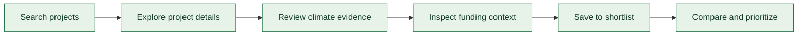
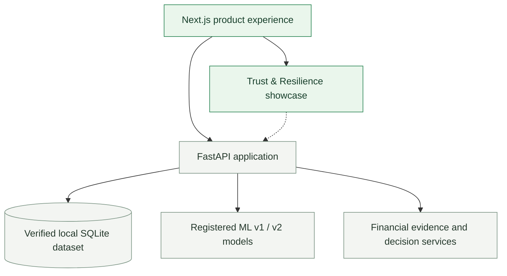

<div align="center">

# 🌱 COMPASSIO

### Give Green Funding a Better Direction.

**Discover climate-related projects. Understand the evidence. Build a shortlist worth reviewing.**

A thoughtfully designed **Green FinTech intelligence platform** that helps climate-finance researchers explore development projects, understand their potential climate relevance, and navigate historical funding evidence—without getting lost in spreadsheets.

**Built for BATTLEVERSE 2026** · **Next.js** · **FastAPI** · **Machine Learning** · **Financial Intelligence**

[Explore the Experience](#-the-compassio-experience) · [How It Works](#-how-it-works) · [Trust & Resilience](#-trust--resilience) · [Run Locally](#-run-locally)

</div>

---

## 🌍 The problem we're solving

Climate-related development projects are documented across different sources, with descriptions, funding records, and evidence that can be difficult to interpret together.

For an analyst, a seemingly simple question—**“Which projects deserve a closer look?”**—can turn into hours of searching, checking context, and comparing figures that may not even be directly comparable.

**COMPASSIO makes the first step easier.** It brings project discovery, climate-relevance screening, funding evidence, and shortlisting into one focused workflow. It supports **human judgment**; it doesn't make funding approvals or claim to verify environmental outcomes.

## ✨ The COMPASSIO experience

> **One user journey. Three clear steps.**

<table>
<tr>
<td width="33%" valign="top">

### 01 · Discover 🔎

Search real development-project records by keyword, country, and topic. Use simple filters and explore readable project cards—not a wall of raw database fields.

</td>
<td width="33%" valign="top">

### 02 · Understand 🌿

Open a project to see its purpose, available climate evidence, and relevant historical funding facts. Use optional ML-assisted screening with explanations where access permits.

</td>
<td width="33%" valign="top">

### 03 · Shortlist 📌

Save interesting projects, compare their evidence, and prioritize which ones merit further investigation. Understand missing information and financial comparability warnings.

</td>
</tr>
</table>

### What you can do

- **Search with intent:** Explore projects through a search-first interface, useful topic suggestions, and progressively disclosed filters.
- **Get context, not just data:** Read project summaries, sources, climate-related evidence, and funding information in one place.
- **Screen project descriptions:** Use *Compassio Climate Intelligence* (ML v2) for a climate-relevance signal and supporting text explanations, subject to source and access restrictions.
- **Compare responsibly:** Keep currencies, finance types, sources, and reporting bases distinct; flag duplicates and missing values instead of inventing totals.
- **Build a practical shortlist:** Save and compare projects locally without manually entering database identifiers.
- **Explore advanced tools when needed:** Historical analytics and hypothetical budget scenarios stay available without overwhelming the core experience.

**Design philosophy:** A polished decision-support product, **not an Excel sheet disguised as a dashboard**.

## 🧭 How it works



**An example journey:** Search for *flood* projects in *Pakistan* → open a project → check its description and supporting evidence → review historical funding → save it → compare it with another project.

## 🛡️ Trust & Resilience

COMPASSIO also includes three separately evaluated BATTLEVERSE challenge defenses, presented in a dedicated **Trust & Resilience** showcase. These are measured **challenge demonstrations**, not claims of production-grade security or independent scientific validation.

| Challenge | What it addresses | Evidence from the local challenge assessment |
|:--|:--|:--|
| **C05 · Data Integrity Shield** | Suspicious training-label changes | Hardened candidate caught **187/666** targeted poisoned labels; trade-offs and residual failures remain |
| **C09 · Input Protection** | Small adversarial text perturbations | Fixed-attack prediction flips **5 → 2** (1,280 pairs); transferred-search **8 → 2** (512 pairs) |
| **C11 · Availability Shield** | Excessive automated API requests | Local fixture-backed tests at approximately **200 bot requests/s**, with **5,953/6,400** bot requests receiving HTTP 429 |

<details>
<summary><strong>Read the important limitations</strong></summary>

- **C05:** The hardened candidate improves targeted detection but does not fully counter targeted poisoning and can miss uniform poisoning.
- **C09:** Five prediction flips remained under 512 adaptive attack pairs; clean assessment scores were unchanged on 256 records. This is development-record evidence, not an adversarial-robustness guarantee.
- **C11:** All 96 independent-peer legitimate requests succeeded in the recorded fixture-backed test, but legitimate screening requests sharing an abusive IP were throttled. The test does not establish canonical-model 200-RPS capacity or multiworker protection.
- Challenge defenses are integrated with clearly documented local-demo controls. C09 and C11 are **opt-in**, and the original behavior remains available.

</details>

For the full methodology and results, see:

- [`docs/hackathon/combined_challenge_scorecard.md`](docs/hackathon/combined_challenge_scorecard.md)
- [`docs/challenges/`](docs/challenges/)
- [`docs/hackathon/final_judge_runbook.md`](docs/hackathon/final_judge_runbook.md)

## 🧱 Built with

| Layer | Technology | Role |
|:--|:--|:--|
| **Experience** | Next.js, React, TypeScript, Tailwind CSS | Responsive, accessible product interface |
| **Application API** | Python, FastAPI, Pydantic | Project search, screening, evidence, comparison, scenarios |
| **Data** | SQLAlchemy, Alembic, SQLite | Locally verified read-only project and historical financial data |
| **Climate intelligence** | scikit-learn, TF-IDF, logistic regression | Text-based climate-relevance screening and explanations |
| **Reliability** | CORS/access controls, request limits, concurrency safeguards | Safer API operation in the documented local-demo scope |
| **Quality** | pytest, Playwright, Ruff, mypy, pnpm | Backend, browser, contract, and type verification |

### Architecture at a glance



## 🚀 Run locally

> **Current supported scope:** Authorized, single-machine hackathon demonstration. The public production API intentionally fails closed for restricted data and model operations.

### Prerequisites

- **Python 3.12** and [`uv`](https://docs.astral.sh/uv/)
- **Node.js 20.9+** and the project's pinned **pnpm**
- The **five checksum-verified, Git-ignored runtime artifacts**: canonical SQLite database, ML v1 model + manifest, and ML v2 model + manifest
- A configured **authorized local demonstration** environment as described in the project's runbook

> **A fresh clone does not include the restricted database, model binaries, or challenge research caches.** Do not download substitutes or bypass access controls to make the demo appear to work.

### 1. Prepare and verify

From the repository root in **PowerShell**:

```powershell
uv sync --locked

Push-Location apps/web
pnpm.cmd install --frozen-lockfile
Pop-Location

uv run python scripts/runtime_artifacts.py verify
uv run python scripts/demo_preflight.py
uv run compassio-db verify
```

If artifact verification fails, follow the checksum-verified import instructions in the [judge runbook](docs/hackathon/final_judge_runbook.md) using only files you are authorized to use.

### 2. Start the API

**Terminal 1 — repository root**

```powershell
$env:COMPASSIO_CORS_ORIGINS='http://localhost:3032,http://127.0.0.1:3032'
powershell -ExecutionPolicy Bypass -File scripts/start_api.ps1 -Port 8032 -C09 -C11
```

### 3. Start the web app

**Terminal 2 — `apps/web`**

```powershell
$env:NEXT_PUBLIC_COMPASSIO_API_URL='http://127.0.0.1:8032'
pnpm.cmd build
pnpm.cmd start --hostname 127.0.0.1 --port 3032
```

Open **http://127.0.0.1:3032** on the demo machine. For the complete local workflow, optional offline setup, and challenge demonstration commands, follow [`docs/hackathon/final_judge_runbook.md`](docs/hackathon/final_judge_runbook.md).

## ✅ Verification snapshot

The final integrated local build was checked with:

| Verification | Result |
|:--|--:|
| Python tests | **862 passed**, 49 skipped |
| Browser end-to-end journeys | **15 passed** |
| Dedicated challenge tests | **113 passed** |
| Frontend unit tests | **16 passed** |
| Real API smoke | **27 requests**, zero failed checks |
| Canonical database audit | **27/27 figures verified** |
| Runtime artifacts | **5/5 hashes verified** |

Frontend production build, lint, typecheck, API contract generation, Ruff, formatting, and strict mypy also passed in the final integration run. Skipped tests require research/rebuild fixtures or a disposable PostgreSQL service; they are **not** counted as passes.

Full verification details: [`docs/hackathon/final_integration_report.md`](docs/hackathon/final_integration_report.md) and [`docs/hackathon/final_release_readiness.md`](docs/hackathon/final_release_readiness.md).

## 🗂️ Repository guide

```text
apps/
  web/                  Next.js user experience
  api/                  FastAPI service
packages/               Shared application and ML packages
configs/                Versioned configuration
scripts/                Local run, verification, and demo commands
tests/                  Backend, finance, and challenge tests
docs/
  hackathon/             Final runbooks and integration evidence
  challenges/            C05, C09, C11 methodology and scorecards
  frontend/              Product UX and design documentation
```

## 🔐 Data, models & responsible use

COMPASSIO is a **research and decision-support prototype**, not a funding marketplace, lender, grant allocator, investment adviser, or environmental-impact certification service.

- **Climate screening is a text-based relevance signal**, not proof of climate impact or approval eligibility.
- **Financial records are historical and source-specific.** Commitments, approvals, disbursements, currencies, and reporting bases must not be casually combined.
- **Missing information stays missing**; hypothetical budget scenarios do not allocate real funds.
- **Source and model serving rights have not been cleared for public use.** Canonical datasets, trained model files, and restricted research artifacts are intentionally excluded from Git.
- **Public deployment is not ready:** the Next.js frontend needs a separately hosted, rights-reviewed Python backend and an approved public data/model-serving policy. Do not deploy the local-demo authorization mode publicly.

## 🎯 Why COMPASSIO?

Because better climate-finance decisions should begin with **clarity**, not another spreadsheet.

**Discover what matters. Understand the evidence. Decide what to review next.**

<div align="center">

---

**COMPASSIO · Give Green Funding a Better Direction.**  
*Built for BATTLEVERSE 2026*

</div>
